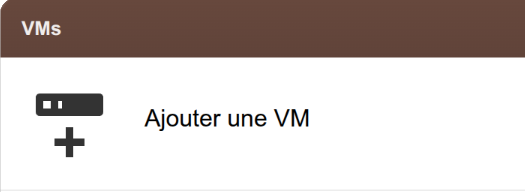
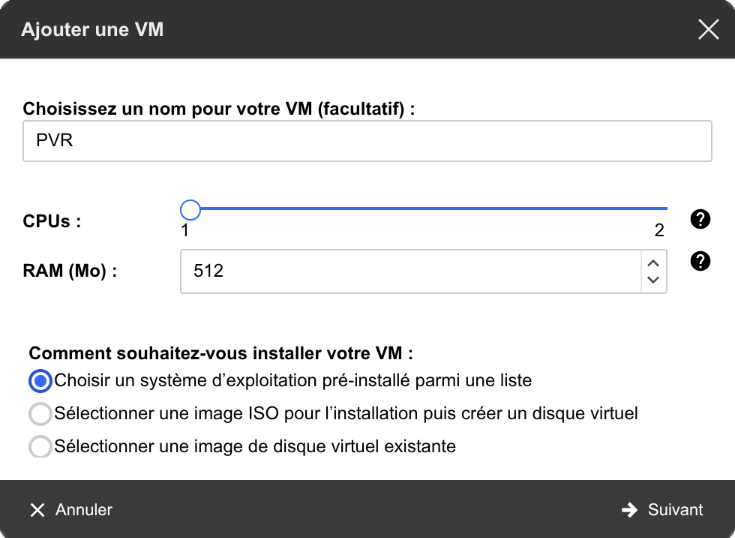
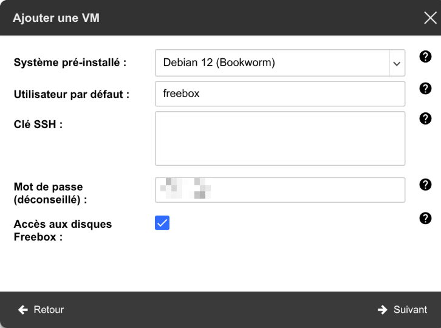
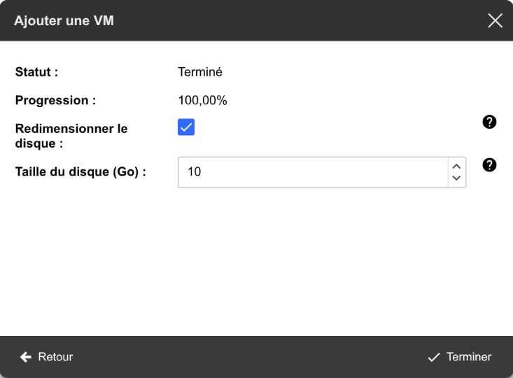
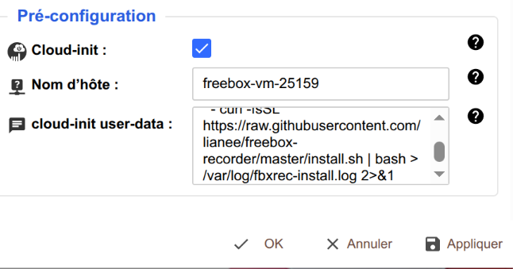
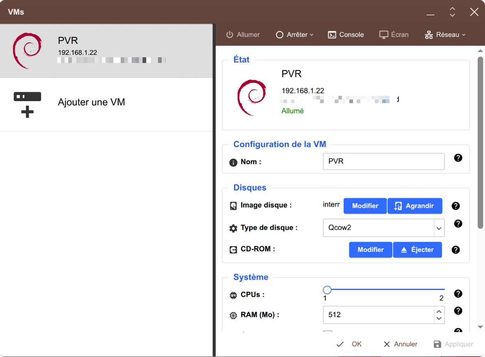
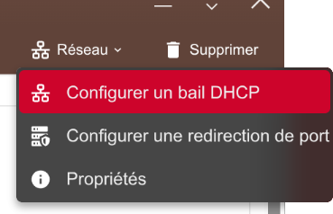

# Enregistreur TV pour Freebox (fbxrec)

Enregistre les chaînes de la Freebox sur le disque de la Freebox, sans PC allumé.
Le programme tourne dans une machine virtuelle (VM) de la Freebox. On programme les
enregistrements (une fois, ou chaque semaine à jours fixes) depuis une page web, sur
n'importe quel appareil du réseau local.

Pourquoi : le magnétoscope intégré de la Freebox abîme une partie des enregistrements
(images manquantes). Ici, chaque enregistrement est vérifié à la fin (taille, trous dans
la vidéo) et le résultat est affiché dans la page.

## Ce qu'il faut

- Une Freebox **Ultra** ou **Delta** (les seules qui proposent des VM). Testé sur Ultra,
  installation réussie sur Delta.
- Les partages Windows activés **avec SMBv2/SMBv3** (Freebox OS, **Paramètres de la
  Freebox > Partages Windows**). Sur Delta ce n'est pas le cas d'office : sans ça, la VM
  ne peut pas écrire sur le disque de la Freebox.
- Un disque dans la Freebox (le disque interne suffit).
- Pas de compte, pas de clé, pas d'application Freebox à autoriser : le programme lit le
  flux TV public de la box (`mafreebox.freebox.fr/freeboxtv/playlist.m3u`).

## Installation sur une nouvelle VM

1. Dans Freebox OS, ouvrez **VMs** puis **Ajouter une VM**.

   

   - Nom : facultatif (par exemple `PVR`), il sert seulement à reconnaître la VM dans
     Freebox OS.
   - **1 CPU et 512 Mo de RAM suffisent** (2 enregistrements simultanés testés : environ
     3 % du processeur, 110 Mo de mémoire). Le reste des ressources de la Freebox reste
     libre pour d'autres VM.
   - Choisissez **un système d'exploitation pré-installé**, puis **Debian 12 (Bookworm)**.

   

2. Écran suivant :
   - Utilisateur par défaut : laissez `freebox`.
   - **Mot de passe** : choisissez-en un vrai (pas de clé SSH nécessaire). Il sert à se
     connecter à la VM par le bouton **Console** de Freebox OS, en cas de souci.
   - Cochez **Accès aux disques Freebox** (Ultra comme Delta) : Freebox OS ajoute alors au
     cloud-init le montage du disque de la Freebox, avec le bon nom selon le modèle.

   

3. Taille du disque : le minimum proposé (10 Go) convient. Les enregistrements ne sont pas
   stockés sur le disque de la VM mais sur celui de la Freebox. Cliquez sur **Terminer** :
   la VM est créée, **ne la démarrez pas encore**.

   

4. Dans la fenêtre VMs, sélectionnez la nouvelle VM : ses propriétés s'affichent. Dans la
   section **Pré-configuration**, la zone **cloud-init user-data** contient ce que Freebox OS
   a préparé. Ne changez rien, ajoutez seulement **une ligne à la fin**, sous `- mount -a`,
   avec les mêmes 2 espaces devant :

   ```yaml
     - curl -fsSL https://raw.githubusercontent.com/lianee/freebox-recorder/master/install.sh | bash > /var/log/fbxrec-install.log 2>&1
   ```

   La fin du cloud-init doit ressembler à ceci :

   ```yaml
   runcmd:
     - mount -a
     - curl -fsSL https://raw.githubusercontent.com/lianee/freebox-recorder/master/install.sh | bash > /var/log/fbxrec-install.log 2>&1
   ```

   Cliquez ensuite sur **Appliquer** pour que la modification soit prise en compte.

   

   À faire **avant le premier démarrage** : cloud-init ne s'exécute qu'au premier
   démarrage. Si vous l'avez oublié, voir « Installation sur une VM existante ».

   Freebox OS y écrit aussi `ssh_pwauth: True` : la connexion SSH par mot de passe est
   ouverte depuis le réseau local. Remplacez `True` par `False` si seule la Console de
   Freebox OS vous suffit.

5. Démarrez la VM. Elle s'installe toute seule : environ 2 minutes sur Ultra, 10 minutes sur
   Delta.
6. Donnez-lui une adresse fixe : dans la fenêtre VMs, menu **Réseau > Configurer un bail
   DHCP**, choisissez une adresse en dehors de la plage distribuée automatiquement. Sinon
   son adresse peut changer, et deux appareils sur la même adresse coupent les
   enregistrements. Redémarrez la VM pour qu'elle la prenne.

   

   

7. Ouvrez `http://<adresse de la VM>:8080/` dans un navigateur, puis définissez un mot de
   passe web dans la section **Paramètres** en bas de la page.

Si la page ne répond pas : bouton **Console** de Freebox OS, connexion avec `freebox` et
votre mot de passe, puis `cat /var/log/fbxrec-install.log` montre le déroulé de
l'installation.

## Installation sur une VM existante

La VM doit être une Debian 12 (ou plus récente) avec systemd. Connectez-vous (bouton
**Console** de Freebox OS, ou SSH) et lancez :

```bash
curl -fsSL https://raw.githubusercontent.com/lianee/freebox-recorder/master/install.sh | sudo bash
```

Le script installe `python3`, `ffmpeg`, `cifs-utils` et `curl`, cherche le disque de la
Freebox (déjà monté, sinon il essaie les noms habituels), lance les tests du programme,
puis démarre le service. Si le disque n'est pas trouvé, il demande le nom du partage,
c'est-à-dire ce qui suit `\\Freebox_Server\` (pas `Freebox_Server` lui-même, qui est le
nom du serveur), ou on le donne d'avance :

```bash
curl -fsSL https://raw.githubusercontent.com/lianee/freebox-recorder/master/install.sh | sudo env FBXREC_SHARE=interne bash
```

Les enregistrements vont dans `<disque Freebox>/Enregistrements TV/<nom>/`, un fichier par
diffusion : `2026-10-31 21h00 - France 2.ts`. Les fichiers `.ts` se lisent avec VLC.

Réglages avancés (dossier de sortie, port) : `/etc/fbxrec.env`, puis `sudo systemctl restart fbxrec`,
**jamais pendant un enregistrement** (il serait coupé).

## Paramètres

Tout se règle depuis la page web, section **Paramètres** en bas : le terminal ne sert
qu'à l'installation. On y trouve la version installée, le dossier des enregistrements et
la place libre sur le disque de la Freebox.

### Mot de passe (recommandé)

Sans mot de passe, tout appareil du réseau local peut programmer ou supprimer des
enregistrements. Dans **Paramètres > Mot de passe**, saisissez-le deux fois et
enregistrez : il est actif tout de suite, le navigateur le demande alors (l'identifiant
n'a pas d'importance). Le même endroit permet de le changer ou de le supprimer.

Mot de passe oublié : dans la VM, `sudo fbxrec-password --remove` le supprime, et
`sudo fbxrec-password` en définit un nouveau.

L'interface est faite pour le réseau local uniquement : ne l'ouvrez pas sur Internet
(pas de redirection de port vers la VM).

### Mise à jour

**Paramètres > Mise à jour > Vérifier** indique si une nouvelle version est publiée, et
le bouton **Mettre à jour** l'installe : téléchargement, tests, puis redémarrage du
service (environ 2 minutes), la page se recharge ensuite. Si un enregistrement est en
cours, la mise à jour refuse et ne touche à rien : relancez-la plus tard.

Depuis un terminal, c'est `sudo fbxrec-update` (et `sudo env FORCE=1 fbxrec-update`
force, en coupant l'enregistrement en cours).

### Système

Les mises à jour de sécurité de Debian s'installent toutes seules chaque jour dans la VM.
Certaines (le noyau surtout) ne prennent effet qu'au redémarrage, et la VM ne redémarre
jamais d'elle-même. Dans ce cas, **Paramètres > Système** affiche « Redémarrage
nécessaire » et propose un bouton **Redémarrer la VM** (environ une minute). Il refuse si
un enregistrement est en cours ou commence dans les 10 minutes.

## Accès à la VM

Le bouton **Console** de Freebox OS suffit (utilisateur `freebox`, mot de passe choisi à la
création). On n'a besoin de s'y connecter que pour une installation sur une VM existante, ou en
cas de souci.

### Accès SSH avec une clé (facultatif)

Pour se connecter depuis le terminal de votre ordinateur sans taper de mot de passe, on peut
donner à Freebox OS une **clé SSH** à la création de la VM (champ « Clé SSH »). Attention :
une VM créée avec une clé et sans mot de passe n'est plus accessible si l'ordinateur qui
détient la clé disparaît. Gardez donc aussi le mot de passe.

**Windows 10 ou 11** : ouvrez le Terminal (clic droit sur le bouton Démarrer, puis
**Terminal** ou **Windows PowerShell**). Regardez d'abord si vous avez déjà une clé :

```powershell
dir $env:USERPROFILE\.ssh\*.pub
```

- Si un fichier s'affiche (par exemple `id_ed25519.pub` ou `id_rsa.pub`), vous avez déjà
  une clé : gardez-la, ne la recréez pas, et passez à la copie ci-dessous en mettant le
  nom de votre fichier.
- Sinon, créez-en une :

  ```powershell
  ssh-keygen -t ed25519
  ```

  Appuyez trois fois sur Entrée (emplacement par défaut, pas de phrase secrète). Si la
  question `Overwrite (y/n)?` apparaît, répondez **n** : une clé existe déjà, l'écraser
  couperait les accès qu'elle ouvre ailleurs.

Copiez ensuite la clé publique dans le presse-papier :

```powershell
Get-Content $env:USERPROFILE\.ssh\id_ed25519.pub | Set-Clipboard
```

**Mac ou Linux** : dans un terminal, `ls ~/.ssh/*.pub`. Si un fichier existe, utilisez-le.
Sinon `ssh-keygen -t ed25519` (trois fois Entrée). Puis `cat ~/.ssh/id_ed25519.pub` (ou le
nom de votre fichier) et copiez la ligne affichée.

La clé publique (le fichier `.pub`, une ligne qui commence par `ssh-ed25519` ou `ssh-rsa`) peut se
montrer sans risque. L'autre fichier, `id_ed25519` sans extension, ne se donne jamais.

## Limites connues

- **TF1 et M6** (et quelques autres) ne sont pas dans le flux public de la Freebox : on ne
  peut pas les enregistrer ainsi. Le magnétoscope de la Freebox, lui, les enregistre
  chiffrés, lisibles seulement par le Player.
- Les flux de l'application **OQEE** sont protégés (DRM) : le programme ne les utilise pas
  et ne cherchera pas à les contourner.
- Le flux de la box passe en RTSP sur **UDP** uniquement. Depuis un PC du réseau, on peut perdre
  des paquets (constaté même en filaire). Depuis la VM, aucune perte constatée.
- Plusieurs enregistrements en même temps : 3 testés sans problème. La limite côté
  Freebox est inconnue.
- Qualité : on choisit SD, HD ou automatique pour chaque programmation. Seule la piste
  audio française est gardée (pas l'audiodescription ni la VO, pas de sous-titres).
- L'heure de fin des émissions n'est pas connue du programme (pas de guide TV) : prévoyez
  une marge.

## Désinstallation

```bash
sudo systemctl disable --now fbxrec
sudo rm -rf /opt/fbxrec /etc/systemd/system/fbxrec.service /etc/systemd/system/fbxrec.service.d /usr/local/bin/fbxrec-update /usr/local/bin/fbxrec-password
```

`/etc/fbxrec.env` et `/var/lib/fbxrec` (programmations, historique) restent, à effacer à la
main si besoin. Les enregistrements sur le disque de la Freebox ne sont jamais touchés.

## Support

Les [issues GitHub](https://github.com/lianee/freebox-recorder/issues) sont ouvertes,
sans engagement : je réponds quand je peux. Joignez la sortie de
`journalctl -u fbxrec -n 100` et votre modèle de Freebox.

## Pour les développeurs

```bash
python3 -m unittest discover -s tests -t .
```

Python 3 sans dépendance (bibliothèque standard), ffmpeg pour la capture. Les tests
utilisent un faux ffmpeg (`tests/fake_ffmpeg.py`). `scripts/deploy.sh` envoie la copie de
travail sur une VM et l'installe avec `install.sh`.

## Licence

MIT, voir [LICENSE](LICENSE).
